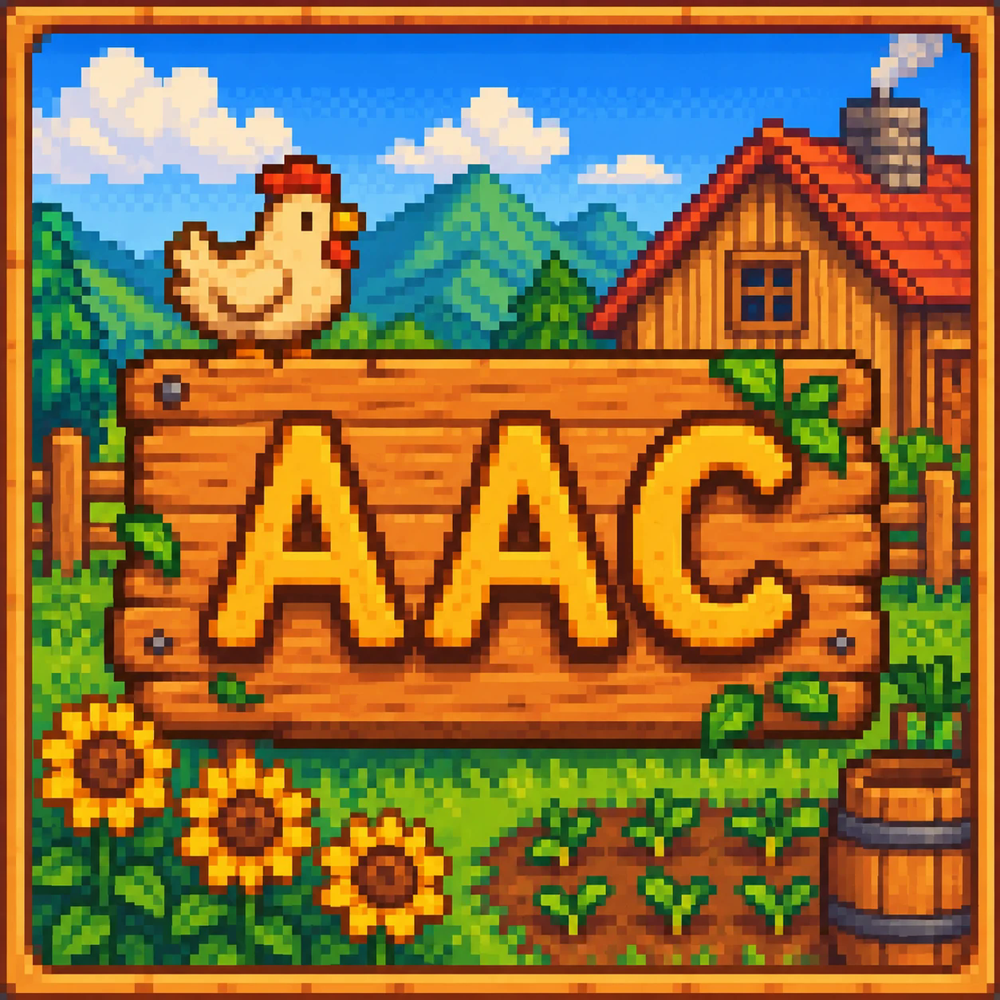

<p align="center"></p>

# (AAC) Auto Animation Cancel

A [SMAPI](https://smapi.io/) mod for Stardew Valley that cancels tool animations the moment the hit lands, allowing faster consecutive swings with a single keybind.

**Download:** [Nexus Mods](https://www.nexusmods.com/stardewvalley/mods/55987)

## Features

- **Hit-frame cancel**: the swing is cut on the tick right after the tool's hit registers, never before. No lost hits.
- **Input buffering**: a press made mid-swing is queued and fires right after the cancel.
- **Target checks**: the keybind only swings when the aimed tile has something the tool can affect.
- **No ghost swings**: the cancel doesn't trigger the game's extra follow-up animation.
- **Vanilla targeting**: aims at the cursor when visible, otherwise at the tile you're facing.
- **Client-side**: works in multiplayer without other players installing it.

## Target checks

| Tool | Valid targets |
|---|---|
| Axe | Trees, fruit trees, stumps (also while falling), destroyable bushes, twigs, weeds, giant crops, mine containers. Large stumps and hollow logs only with a strong enough axe. |
| Pickaxe | Stones, ore and gem nodes, weeds, mine containers, empty tilled soil. Boulders and meteorites only with a strong enough pickaxe. Placed objects are never hit. |
| Hoe | Untilled diggable ground, artifact spots, seed spots, ginger. |
| Watering can | Dry tilled soil, dry garden pots, empty pet bowls, refilling at water when not full. |

Anything else still works with the normal tool button. The keybind always does an uncharged swing; charging stays on the normal tool button. For melee weapons, the keybind acts as a regular attack click.

## Configuration

Edit `config.json` or use [Generic Mod Config Menu](https://www.nexusmods.com/stardewvalley/mods/5098) in game.

| Option | Default | Description |
|---|---|---|
| `CancelKey` | `Space` | Keybind |
| `GuardMisclicks` | `true` | Enable target checks |
| `BufferInput` | `true` | Queue presses made mid-swing |
| `PostHitDelayMs` | `0` | Extra delay before cancelling (ms) |
| `EnableAxe` / `EnablePickaxe` / `EnableHoe` / `EnableWateringCan` / `EnableMeleeWeapons` | `true` | Per-tool toggles |

## Requirements

- Stardew Valley 1.6+
- SMAPI 4.0+
- Generic Mod Config Menu (optional)

## Building from source

Requires the .NET 6 SDK or newer.

```
dotnet build -c Release
```

[Pathoschild.Stardew.ModBuildConfig](https://www.nuget.org/packages/Pathoschild.Stardew.ModBuildConfig) finds your game folder, copies the mod into `Mods`, and creates a release zip in `bin/Release/net6.0/`. If your game is in a custom location, add `<GamePath>…</GamePath>` to the `.csproj`.

## Contact

For questions or issues, contact `@xhvsh` on Discord.
